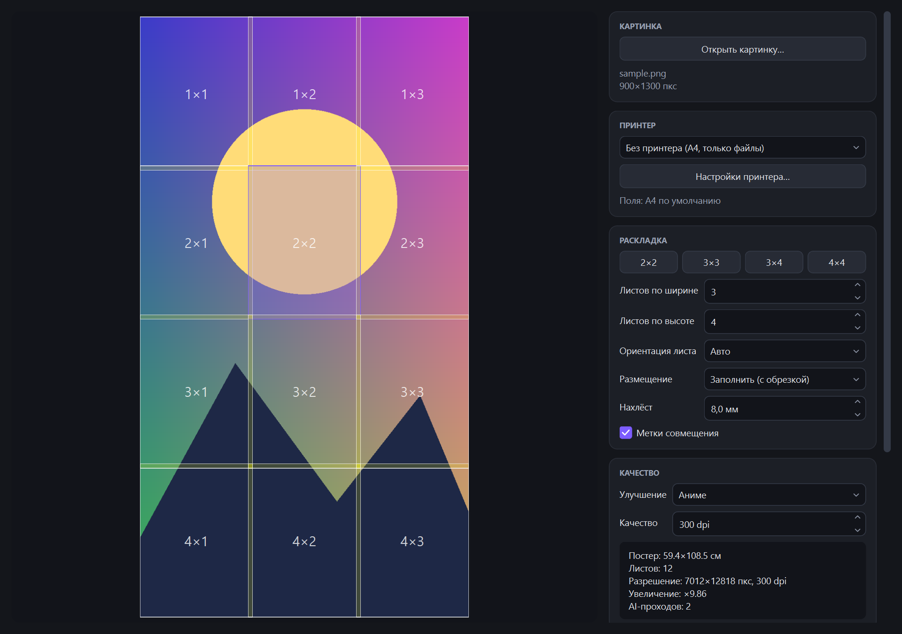
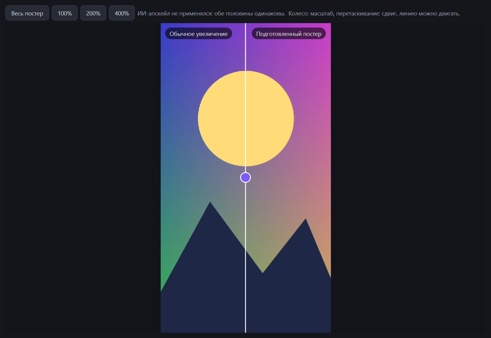

# PosterPrint

**English** | [Русский](README.ru.md)

Print a large poster on several A4 sheets with AI upscaling. Built for the Canon PIXMA E400 series, works
with any Windows printer.



## Why

- Home printers leave white margins, so tiled sheets never line up edge to edge.
- Splitting one picture across 4, 9, 12 or 16 sheets stretches it several times, and even a good image
  drops to 50-100 dpi on paper.

PosterPrint upscales the whole picture to the real size of the poster first, then cuts it into sheets that
overlap, so the result stays sharp and the seams match.

## Features

- Any grid from 1×1 to 10×10, with 2×2, 3×3, 3×4 and 4×4 presets.
- AI upscaling with [Real-ESRGAN](https://github.com/xinntao/Real-ESRGAN) (ncnn + Vulkan): models for
  anime and illustration, for photos, and a fast one for weak GPUs. Works on AMD, NVIDIA and Intel.
- The upscaler (43 MB) is downloaded on first use and verified by SHA-256.
- Margins are read from the printer driver, so asymmetric margins are handled correctly.
- Overlap between sheets with alignment marks and sheet numbers hidden inside the overlap.
- Borderless mode when the printer driver offers it.
- Direct printing without driver scaling, or export to PDF and PNG.
- Every prepared poster is saved as a JPEG in the `output` folder next to the program.
- Before/after viewer with a draggable divider and zoom up to 400%: plain enlargement on one side, the
  prepared poster on the other.
- Update check: on start the program asks GitHub for the latest release and offers to download it.
- Portable: unzip and run, no Python needed.



## Usage

1. Download `PosterPrint.zip` from [Releases](../../releases), unzip it anywhere and run `PosterPrint.exe`.
2. Open or drop an image.
3. Choose the printer and the grid.
4. Pick the enhancement: **Аниме** (anime and illustration), **Фото** (photo and everything else),
   **Быстрое** (fast) or **Без апскейла** (no upscaling).
5. Press **Подготовить** (prepare). The poster is saved to the `output` folder
   (**Папка результатов** opens it).
6. **Сравнить до/после** (compare) shows what the upscaling changed.
7. **Печать всех листов** (print all sheets), or save a PDF or PNGs.

The interface is in Russian.

Offline use: put `realesrgan-ncnn-vulkan-20220424-windows.zip` next to the program as `bin\realesrgan.zip`.

## Assembling the poster

Each sheet overlaps its right and bottom neighbours (8 mm by default). Trim the white margin of the right
or bottom sheet along the joint and glue it over the left or top sheet, matching the black marks. The sheet
number (`row-column`) is printed inside the overlap and ends up hidden.

If your driver supports borderless printing, enable it in **Настройки принтера…** (printer settings) and
the overlap is set to 0.

## Requirements

- Windows 10 or 11, 64-bit.
- A GPU with Vulkan support for AI upscaling (for example Radeon RX 560 or integrated Radeon graphics) and
  up-to-date drivers. Without Vulkan the program falls back to ordinary resampling.

## Status

Early version. The layout, cutting, export and upscale planning are covered by automated tests. Upscaling
on a real GPU and printing on a real Canon E400 have not been verified yet, so print a single sheet first.

## Development

```powershell
py -3.11 -m venv .venv
.venv\Scripts\pip install -r requirements.txt
$env:PYTHONPATH='.'; .venv\Scripts\python -m pytest tests -q
.venv\Scripts\python main.py
.\build.ps1        # dist\PosterPrint.zip
```

| Module | Purpose |
|---|---|
| `app/layout.py` | Grid, printable area, overlap and resolution math |
| `app/upscale.py` | Runs Real-ESRGAN and plans the passes |
| `app/fetch.py` | Downloads and verifies the upscaler |
| `app/tiles.py` | Fits the image, cuts sheets, exports PDF and PNG |
| `app/printer.py` | Reads margins from the driver and prints through GDI |
| `app/pipeline.py` | Image to printable sheets |
| `app/ui.py` | PySide6 window |
| `app/compare.py` | Before/after viewer |
| `app/theme.py` | Dark theme |
| `app/update.py` | Version and update check |

## License

[MIT](LICENSE). Real-ESRGAN is downloaded at run time and is licensed under BSD-3-Clause. The portable
build bundles PySide6 (LGPL-3.0), Pillow and pywin32.
