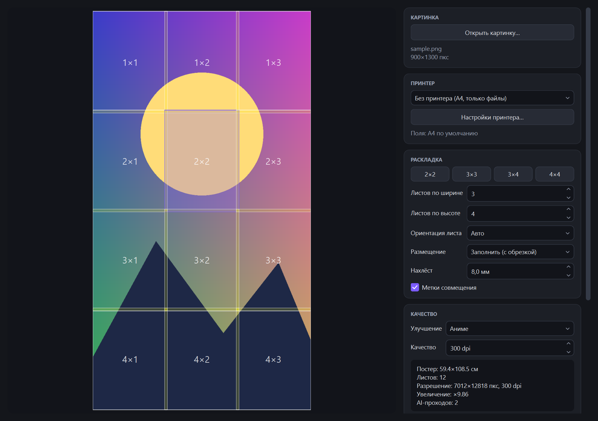
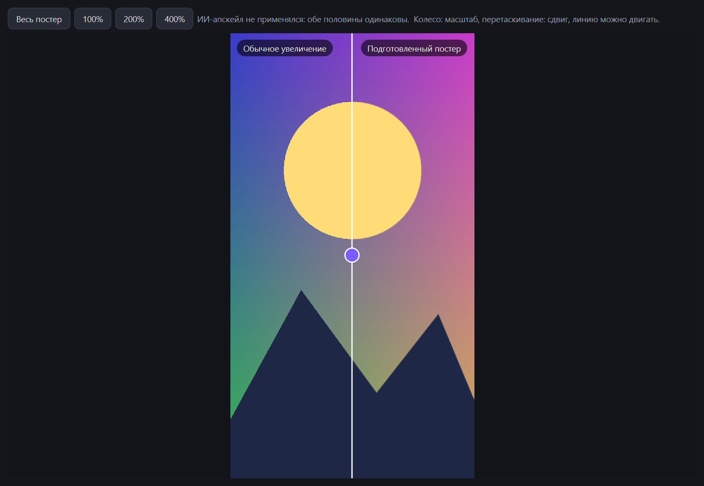

# PosterPrint

[English](README.md) | **Русский**

Печать большого постера на нескольких листах A4 с ИИ-апскейлом. Сделано под Canon PIXMA E400 series,
работает с любым принтером Windows.



## Зачем

- Домашние принтеры оставляют белые поля, и листы не стыкуются край в край.
- При делении картинки на 4, 9, 12 или 16 листов она растягивается в несколько раз, и даже хорошее
  изображение даёт на бумаге 50-100 dpi.

PosterPrint сначала увеличивает всю картинку до реального размера постера, а потом режет её на листы с
нахлёстом. Так сохраняется резкость и совпадают стыки.

## Возможности

- Любая сетка от 1×1 до 10×10, пресеты 2×2, 3×3, 3×4 и 4×4.
- ИИ-апскейл через [Real-ESRGAN](https://github.com/xinntao/Real-ESRGAN) (ncnn + Vulkan): модели для
  аниме и иллюстраций, для фото и быстрая для слабых видеокарт. Работает на AMD, NVIDIA и Intel.
- Апскейлер (43 МБ) скачивается при первом использовании и проверяется по SHA-256.
- Поля читаются из драйвера принтера, поэтому несимметричные поля учитываются правильно.
- Нахлёст листов с метками совмещения и номерами листов, спрятанными в полосе нахлёста.
- Режим без полей, если драйвер принтера его поддерживает.
- Прямая печать без масштабирования драйвером или экспорт в PDF и PNG.
- Каждый подготовленный постер сохраняется в JPEG в папку `output` рядом с программой.
- Сравнение «до/после» с подвижной границей и масштабом до 400%: с одной стороны обычное увеличение,
  с другой подготовленный постер.
- Проверка обновлений: при запуске программа спрашивает у GitHub последний релиз и предлагает его скачать.
- Portable: распаковать и запустить, Python не нужен.



## Как пользоваться

1. Скачать `PosterPrint.zip` из [Releases](../../releases), распаковать в любую папку и запустить
   `PosterPrint.exe`.
2. Открыть или перетащить картинку.
3. Выбрать принтер и сетку.
4. Выбрать улучшение: **Аниме** (аниме и иллюстрации), **Фото** (фото и всё остальное), **Быстрое** или
   **Без апскейла**.
5. Нажать **Подготовить**. Постер сохранится в папку `output` (её открывает **Папка результатов**).
6. **Сравнить до/после** показывает, что изменил апскейл.
7. **Печать всех листов**, либо сохранить PDF или PNG.

Без интернета: положить `realesrgan-ncnn-vulkan-20220424-windows.zip` рядом с программой как
`bin\realesrgan.zip`.

## Склейка постера

Каждый лист перекрывает правого и нижнего соседа (по умолчанию на 8 мм). У правого или нижнего листа
обрежьте белое поле со стороны стыка и наклейте его поверх левого или верхнего по чёрным меткам. Номер
листа (`ряд-колонка`) напечатан в полосе нахлёста и окажется закрыт.

Если драйвер умеет печать без полей, включите её в **Настройки принтера…** - нахлёст станет равен 0.

## Требования

- Windows 10 или 11, 64-бит.
- Для ИИ-апскейла нужна видеокарта с Vulkan (например, Radeon RX 560 или встроенная графика Radeon) и
  свежие драйверы. Без Vulkan программа делает обычное увеличение.

## Статус

Ранняя версия. Раскладка, нарезка, экспорт и планирование апскейла покрыты автотестами. Апскейл на
реальной видеокарте и печать на реальном Canon E400 ещё не проверены, поэтому сначала напечатайте один лист.

## Разработка

```powershell
py -3.11 -m venv .venv
.venv\Scripts\pip install -r requirements.txt
$env:PYTHONPATH='.'; .venv\Scripts\python -m pytest tests -q
.venv\Scripts\python main.py
.\build.ps1        # dist\PosterPrint.zip
```

| Модуль | Назначение |
|---|---|
| `app/layout.py` | Сетка, печатная область, нахлёст и расчёт разрешения |
| `app/upscale.py` | Запуск Real-ESRGAN и планирование прогонов |
| `app/fetch.py` | Загрузка и проверка апскейлера |
| `app/tiles.py` | Подгонка картинки, нарезка листов, экспорт PDF и PNG |
| `app/printer.py` | Чтение полей из драйвера и печать через GDI |
| `app/pipeline.py` | От картинки до готовых листов |
| `app/ui.py` | Окно на PySide6 |
| `app/compare.py` | Сравнение до и после |
| `app/theme.py` | Тёмная тема |
| `app/update.py` | Версия и проверка обновлений |

## Лицензия

[MIT](LICENSE). Real-ESRGAN скачивается во время работы и распространяется под BSD-3-Clause. В portable-сборку
входят PySide6 (LGPL-3.0), Pillow и pywin32.
